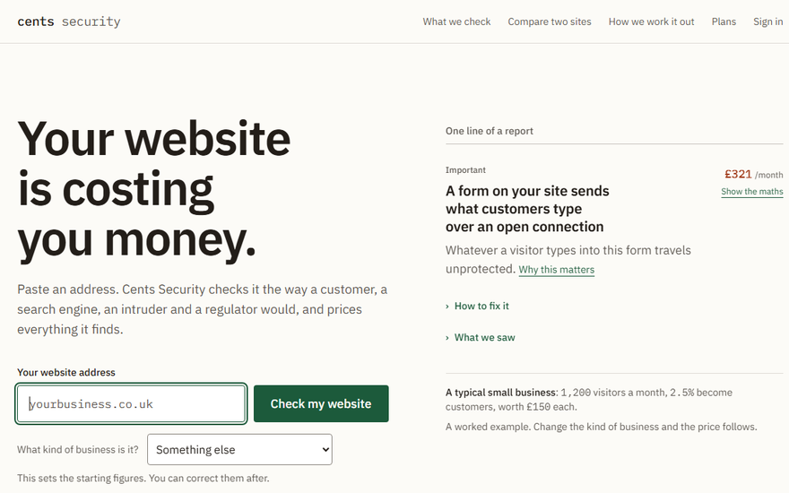
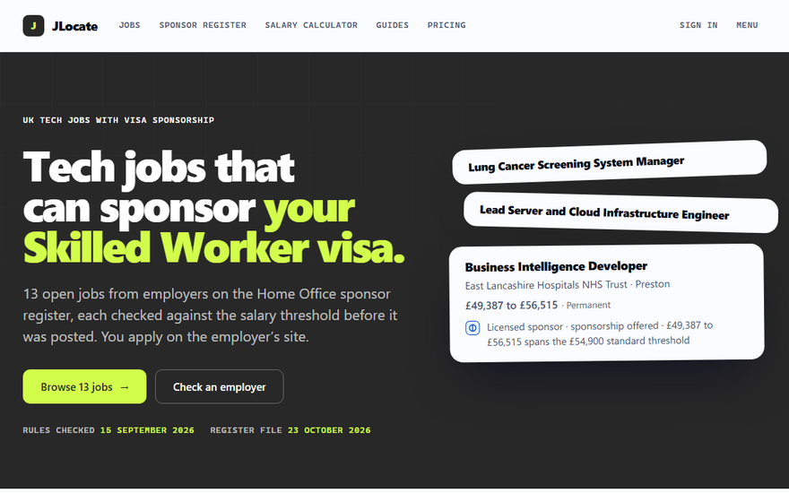
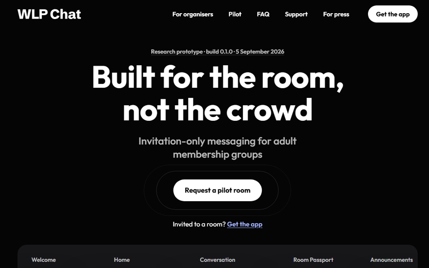

Founder and software engineer at [Valten Studio](https://valtenstudio.com/en-gb), a web studio for owner-led businesses.

I built the three products below and host them on my own VPS behind Caddy. The code is private, so the links go to the live sites.

<table>
<tr>
<td width="33%" valign="top">

<h3><a href="https://www.cents-security.com">Cents Security</a></h3>
Website checker for small businesses. It has 169 checks for security, search and privacy problems, and it puts a monthly £ cost on each finding with the maths shown.
  
Next.js · TypeScript · Redis
</td>
<td width="33%" valign="top">

<h3><a href="https://jlocate.com">JLocate</a></h3>
UK tech jobs for international students and graduates. JLocate checks each employer against the Home Office sponsor register and each salary against the Skilled Worker rules.
  
React · Vite · Payload CMS · PostgreSQL
</td>
<td width="33%" valign="top">

<h3><a href="https://wlpchat.club">WLP Chat</a></h3>
Invite-only messenger for adult membership groups. Members join through invite links that expire and use a different name in each room. The app is a research prototype.
  
Astro · React Native · Expo
</td>
</tr>
</table>

### Open source

- [**bloatrail**](https://github.com/Juuzoe/bloatrail) is a disk analyser for developers, with a CLI and a desktop app. It reads the project files around a folder before deciding what you can delete. Rust, 315 tests.
- [**contextpoint**](https://github.com/Juuzoe/contextpoint) keeps a project's AI context in VS Code (task, constraints, failed attempts, git changes) and hands Claude a short prompt. It also runs as an MCP server. On the [Marketplace](https://marketplace.visualstudio.com/items?itemName=valten-studio.contextpoint).
- [**ap-alg**](https://github.com/Juuzoe/ap-alg) turns salary and experience range matching into an inner product a vector database can rank by, with a proved error bound. [Demo](https://juuzoe.github.io/ap-alg/demo/).
- [**AffectLab**](https://github.com/Juuzoe/PythonEmotionDetecter) estimates emotion and heart rate from an ordinary webcam in real time. Python, OpenCV, MediaPipe.
- [**uptime_tracker**](https://github.com/Juuzoe/uptime_tracker) watches your websites from a live dashboard and sends Telegram alerts when one goes down or its certificate is about to expire. Node.js and SQLite.
- [**stop-design-slop**](https://github.com/Juuzoe/stop-design-slop) is an agent skill for Claude Code and Codex that finds and removes AI design patterns from a website.

### Contact

Open to software engineering roles. Email me at [mgavrylenko05@gmail.com](mailto:mgavrylenko05@gmail.com) or message me on [LinkedIn](https://www.linkedin.com/in/maksym-gavrylenko-70b588322/).
